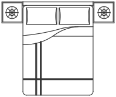
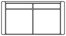
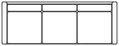
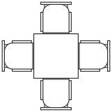
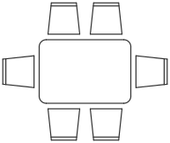
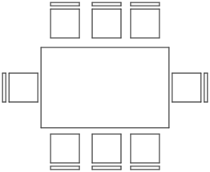
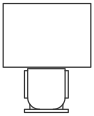

# Furniture

When you tick **Furnished** in the [Plan tab](plan.md#step-2-topology-and-generate), Termite adds furniture to the layout it generates. Beds go in the bedrooms, sofas in the living room, a dining table, a kitchen set, and the toilet, washbasin and bath in the bathroom. When you load the plan into your model, the furniture comes with it.

Termite uses one fixed set of standard furniture. Every piece has a real-world size, so a furnished plan also shows you whether the rooms are big enough to live in.

---

## Where you get furniture

| CAD tool | Furniture |
|---|---|
| **Rhino** | 2D plan blocks |
| **Revit** | 3D furniture families |
| **Archicad** | 3D objects (Archicad 29) |

---

## Sizes

Sizes are given as **width × depth** in centimeters. Width is measured along the front of the piece, depth from back to front.

Beds, sofas, kitchen sets and the other wall pieces stand with their back to a wall. Dining tables stand free in the room.

The pictures below are plan views (seen from above) and use the same scale, so you can compare them with each other.

---

## Standard furniture

  

    

    
single bed

    
158 × 195 cm

  

  

    

    
double bed

    
240 × 200 cm

  

  

    

    
sofa 2

    
164 × 86 cm

  

  

    

    
sofa 3

    
235 × 86 cm

  

  

    

    
dining table 2

    
194 × 80 cm

  

  

    

    
dining table 4

    
194 × 194 cm

  

  

    

    
dining table 6

    
233 × 194 cm

  

  

    

    
dining table 8

    
320 × 260 cm

  

  

    

    
kitchen set 1

    
197 × 54 cm

  

  

    

    
kitchen set 2

    
305 × 60 cm

  

  

    

    
toilet

    
54 × 74 cm

  

  

    

    
washbasin

    
75 × 54 cm

  

  

    

    
bath

    
90 × 90 cm

  

  

    

    
desk

    
110 × 137 cm

  

  

    

    
dresser

    
180 × 60 cm

  

  

    

    
tv

    
150 × 30 cm

  

!!! note
    The furniture sizes are fixed. Choosing your own furniture or changing the sizes is not available yet.
